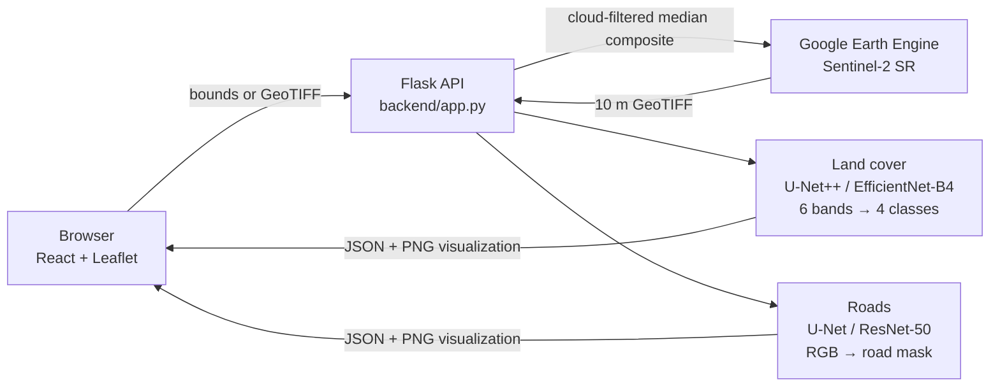

# GeoSight 🌍

GeoSight maps land use from Sentinel-2 satellite imagery. Pick an area on a map (or upload a
GeoTIFF) and it:

- labels every 10 m pixel as **Background, Rural, Urban or Water**, using a U-Net++ /
  EfficientNet-B4 segmentation model, and
- detects **roads**, using a separate U-Net / ResNet-50 model.

Results appear in a React web app with class percentages, model confidence and a 4-panel
visualization (image, raw prediction, filtered prediction, overlay).

## How it works



| Model | Input | Output | Training script |
|---|---|---|---|
| Land cover | Sentinel-2 B2, B3, B4, B8, B11, B12 (reflectance ÷ 10000) | Background / Rural / Urban / Water per pixel | `Training/train_unetpp_6band.py` |
| Roads | Sentinel-2 B4, B3, B2 (RGB), 256×256, ImageNet normalization | road / non-road per pixel | `Scripts/Training/Kaggle_Road_Test.py` |

Full details (architecture, preprocessing, checksums): [docs/MODELS.md](docs/MODELS.md).

**Dataset:** 69,614 Sentinel-2 tiles from Delhi, Haryana, Kanpur, Sikkim and Uttarakhand
(`geosight_manifest_70k.csv`), labelled semi-automatically with the scripts in `data_scripts/`.
The land-cover model was trained for 30 epochs with Dice + Focal loss, and the **epoch 11**
checkpoint was selected using the per-epoch analysis in `all_epochs_analysis/`.

## Requirements

- Python 3.11+ and Node.js 18+
- A Google account with access to a Google Cloud project registered for Earth Engine
  (only needed for map-based analysis; uploads work without it)
- The two model checkpoints (not in git, see below)
- Optional: an NVIDIA GPU with CUDA. Everything also runs on CPU, just slower.

## Setup

### 1. Python environment

```bash
python -m venv venv
venv\Scripts\activate          # Windows   (macOS/Linux: source venv/bin/activate)

# Backend only (CPU):
pip install -r backend/requirements.txt

# Everything incl. training, with GPU: install CUDA PyTorch first, then the rest
pip install torch==2.6.0 torchvision==0.21.0 --index-url https://download.pytorch.org/whl/cu124
pip install -r requirements.txt
```

### 2. Model checkpoints

Get the files from a project maintainer and place them here:

```text
checkpoints/geosight_final_epoch_11.pt
Models/GeoSight_RoadExpert_Final_PyTorch.pt
```

Other locations work via `GEOSIGHT_MODEL_PATH` / `GEOSIGHT_ROAD_MODEL_PATH`.
Checksums and details: [docs/MODELS.md](docs/MODELS.md).

### 3. Earth Engine

```bash
earthengine authenticate
```

The backend uses the Cloud project in `GEOSIGHT_EE_PROJECT` (default
`gen-lang-client-0871361958`). Set it to your own project if that one is not available to you.
If Earth Engine cannot be initialised, the backend still starts: `/api/health` reports
`"earth_engine": "not configured"` and the map endpoints return HTTP 503.

### 4. Frontend

```bash
cd Geosight_frontend/geosight
npm install
copy .env.example .env         # macOS/Linux: cp .env.example .env
```

`.env` sets `VITE_API_BASE_URL`, the address of the backend (default `http://localhost:5000`).

## Running

**Windows, one click:** `start_system.bat` starts both servers and prints the URL.

**Manually**, in two terminals:

```bash
python backend/app.py
```

```bash
cd Geosight_frontend/geosight
npm run dev
```

Open <http://localhost:5173/demo>.

- **Select from Map:** search a place or enter coordinates, draw a rectangle (up to ~150 km²),
  choose *Land Classification* or *Road Detection*, then click *Analyze*.
- **Upload Image:** upload a Sentinel-2 GeoTIFF with at least 6 bands in the order
  B2, B3, B4, B8, B11, B12. JPG/PNG are not supported because the model needs the infrared bands.

### Backend configuration

| Variable | Default | Purpose |
|---|---|---|
| `GEOSIGHT_HOST` | `127.0.0.1` | Interface to bind. `0.0.0.0` exposes the API to your network. |
| `GEOSIGHT_PORT` | `5000` | Port |
| `GEOSIGHT_DEBUG` | off | `1` enables Flask debug mode. **Never on a shared network**: the debugger can run arbitrary code. |
| `GEOSIGHT_CORS_ORIGINS` | `http://localhost:5173,http://127.0.0.1:5173` | Frontend origins allowed to call the API |
| `GEOSIGHT_EE_PROJECT` | `gen-lang-client-0871361958` | Earth Engine Cloud project |
| `GEOSIGHT_MODEL_PATH` | `checkpoints/geosight_final_epoch_11.pt` | Land-cover checkpoint |
| `GEOSIGHT_ROAD_MODEL_PATH` | `Models/GeoSight_RoadExpert_Final_PyTorch.pt` | Road checkpoint |
| `GEOSIGHT_OUTPUT_DIR` | `backend_outputs/` | Downloaded and generated files |
| `GEOSIGHT_DATA_ROOT` | repository root | Where training/analysis scripts look for datasets |

For a deployment, use a production server instead of `python app.py`:

```bash
cd backend
waitress-serve --host 0.0.0.0 --port 5000 app:app
```

## API

| Method | Endpoint | Description |
|---|---|---|
| GET | `/api/health` | Server status, Earth Engine and model availability |
| POST | `/api/fetch-image` | Fetch Sentinel-2 for an area and run land-cover classification |
| POST | `/api/detect-roads` | Fetch Sentinel-2 RGB for an area and detect roads |
| POST | `/api/predict-upload` | Classify an uploaded GeoTIFF (`multipart/form-data`, field `file`) |
| GET | `/api/download/<filename>` | Download a generated `.tif` or `.png` |

Example:

```bash
curl -X POST http://localhost:5000/api/fetch-image -H "Content-Type: application/json" -d "{\"bounds\": {\"minLon\": 77.20, \"minLat\": 28.60, \"maxLon\": 77.22, \"maxLat\": 28.62}, \"cloudCover\": 10, \"startDate\": \"2024-01-01\", \"endDate\": \"2024-12-31\"}"
```

The response includes `prediction.dominant_class`, `prediction.class_distribution`
(percentage of pixels and mean confidence per class) and `visualization_4panel` (a PNG you can
fetch from `/api/download/`). Invalid input returns HTTP 400 with an `error` message.

## Testing

```bash
pip install -r requirements-dev.txt
pytest
```

The suite covers uploads, request validation, security (path traversal, CORS, debug defaults),
configuration, the Earth Engine endpoints (with Earth Engine stubbed out) and
training/inference compatibility. Tests that need the real checkpoint are skipped when it's
missing; set `GEOSIGHT_CHECKPOINT` to point at it.

Frontend checks:

```bash
cd Geosight_frontend/geosight
npm run lint
npm run build
```

## Measuring model accuracy

```bash
python Training/evaluate_models.py classification --images <tiles> --masks <masks> --checkpoint checkpoints/geosight_final_epoch_11.pt
python Training/evaluate_models.py roads --images <tiles> --masks <road masks> --checkpoint Models/GeoSight_RoadExpert_Final_PyTorch.pt
```

This scores the model on the held-out validation split (confusion matrix, per-class
precision/recall/F1/IoU) and writes the results to
`Geosight_frontend/geosight/src/data/modelEvaluation.json`, where the Insights and About pages
display them. Until it has been run, those pages show "Not evaluated yet" rather than estimates.

## Project structure

```text
backend/              Flask API and model inference
Geosight_frontend/    React (Vite) web app
Training/             Model training and evaluation scripts
Scripts/              Experiments: per-city testing, visualization, data processing
data_scripts/         Dataset building and auto-labelling
tools/                Small analysis, Earth Engine and model utilities
tests/                Automated test suite (pytest); tests/manual has hand-run scripts
docs/                 Model details, project logbook, historical development notes
all_epochs_analysis/  Per-epoch class-coverage analysis used to pick the checkpoint
```

## Known limitations

- Accuracy against ground truth has not been published yet; run `Training/evaluate_models.py`
  to measure it. The coverage figures in `all_epochs_analysis/` show what the model predicts,
  not how often it is right.
- The road model returns high road coverage for dense city centres. Check it against road
  masks before relying on the percentage.
- Land-cover classes were labelled semi-automatically, so Urban/Rural boundaries in peri-urban
  areas are approximate.
- Map analysis is limited to about 150 km² per request (Earth Engine download size).
